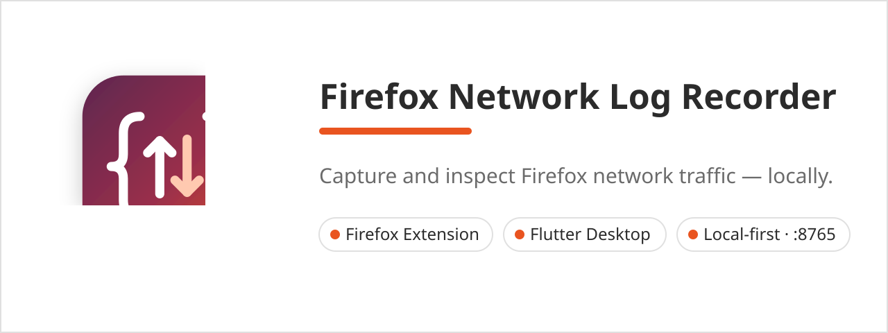

# Firefox Network Log Recorder



Record the network traffic of a Firefox browsing session - log in to your own
website, click around - and inspect every request in a desktop viewer.
**100% local:** the viewer serves only `127.0.0.1:8765`, storage is a local
SQLite database, nothing ever leaves your machine.

## Components

| Part | Folder | Stack |
|---|---|---|
| Browser extension | `extension/` | Firefox Manifest V2, `webRequest` API |
| Desktop viewer | `flutter-desktop-app/` | Flutter + Yaru (Ubuntu style), Windows target |

```
Firefox ──webRequest──► extension background ──HTTP POST /api/logs──► Flutter viewer ──► SQLite
                              (buffer ≤500)        127.0.0.1:8765          %LOCALAPPDATA%\NetworkLogViewer\logs.db
```

## Features

**Extension** - toolbar popup with recording toggle, `REC` badge, viewer-online
indicator (`GET /api/ping`), live counters (stored / captured / skipped /
sent / failed), **Resend all** and **Export JSON** for offline sessions.
Captures method, URL, request/response headers, request body (form + raw,
decoded), status, timing, duration and errors. Static-asset `GET`s
(image, script, stylesheet, font, manifest) are skipped by default.

**Desktop viewer** - live request table, per-website sidebar with search,
full-text log search, details dialog with Overview / Request / Response /
**Edit & Run** / Raw tabs, request replay with redirect control, copy-as-cURL,
JSON + XML import/export, dark-mode-ready Yaru theme.

## Quick start

Prerequisites: [Flutter SDK](https://docs.flutter.dev/get-started/install/windows)
with Windows desktop enabled (`flutter config --enable-windows-desktop`),
and Firefox.

```powershell
# 1. Run the viewer (debug, hot-reload). First run does `flutter pub get`.
python tools/run_windows.py

# Launch the prebuilt exe without rebuilding:
python tools/run_windows.py --exe

# Release run / build only / analyze first:
python tools/run_windows.py --release
python tools/run_windows.py --build-only
python tools/run_windows.py --analyze
```

The viewer starts its server automatically. If port `8765` is taken you'll see
a warning in the terminal and a banner in the app.

## Load the extension in Firefox

1. Start the desktop viewer (above).
2. Open `about:debugging#/runtime/this-firefox`.
3. Click **Load Temporary Add-on…** and select `extension/manifest.json`.
4. Click the toolbar icon: the badge should show **viewer online**.
5. Turn **Recording** on (`REC` badge), log in to your site, navigate around -
   requests stream into the viewer live.

To keep it permanently: zip the **contents** of `extension/`, have it signed,
or use `about:config` + `xpinstall.signatures.required = false` with a
packaged `.xpi`.

## What is captured

| Field | Source |
|---|---|
| Method, URL, type, tab, timestamp | `webRequest.onBeforeRequest` |
| Request headers | `webRequest.onBeforeSendHeaders` |
| Request body (form data or raw bytes, decoded) | `webRequest.onBeforeRequest` (`requestBody`) |
| Response headers, status | `webRequest.onHeadersReceived` |
| Duration, cache flag, errors | `onCompleted` / `onErrorOccurred` |

Skipped automatically: the extension's own uploads to the viewer, non-HTTP
schemes, and (while "Skip static GETs" is on) `GET` requests of type `image`,
`imageset`, `stylesheet`, `script`, `font`, `manifest`, `web_manifest`.

## Server API

| Method | Path | Description |
|---|---|---|
| `GET` | `/api/ping` | `"pong"` - viewer-online indicator |
| `GET` | `/api/health` | `{ status, port, count }` |
| `GET` | `/api/logs` | All buffered records as JSON |
| `POST` | `/api/logs` | Ingest one record or an array |
| `DELETE` | `/api/logs` | Clear the server buffer |

## Storage

```
%LOCALAPPDATA%\NetworkLogViewer\logs.db
```

Every received/imported record lands in a `records` table (indexed on `url`,
`method`, `received_at`) and reloads on launch. **Clear** wipes the extension
buffer and the database. JSON/XML import/export moves logs between machines.

Popup settings (`browser.storage.local`): **Recording**, **Skip static GETs**,
**Viewer server URL** (default `http://127.0.0.1:8765`).

## Project structure

```
├── extension/               Firefox extension (manifest.json, background.js, popup.*)
├── flutter-desktop-app/     Flutter viewer (lib/, windows/, test/)
│   └── lib/
│       ├── main.dart        Yaru theme + app bootstrap
│       ├── app_state.dart   sites, selection, filters
│       ├── log_server.dart  127.0.0.1:8765 HTTP API
│       ├── log_database.dart SQLite persistence
│       └── ui/              sidebar, table, dialogs, replay editor
├── branding/                logo.svg, icons (all sizes), banners, store assets
│   ├── icons/               Windows set + app_icon.ico
│   ├── icons/linux/         hicolor theme for future GNOME packaging
│   └── store/               AMO / Snap / Microsoft Store graphics + checklist
├── tools/run_windows.py       one-command launcher (run / build / exe / analyze)
├── tools/build_windows.py     release exe + installer builder
├── LICENSE                  MIT - open source, attribution required
└── branding.md              palette, logo spec, icon matrix (for designers/AI)
```

## Releasing

1. Bump the version in `flutter-desktop-app/pubspec.yaml`,
   `extension/manifest.json`, and `installer/network-log-recorder.iss`.
2. Rebuild artifacts: `python extension/build.py` and
   `python tools/build_windows.py --sign`.
3. Publish (release title convention: `Browser-Network-Log-Recorder vX.Y.Z`):
   `gh release create vX.Y.Z --title "Browser-Network-Log-Recorder vX.Y.Z"
   --notes "..." installer/output/*.exe extension/dist/*.xpi`

## Branding

Ubuntu/Yaru look: accent `#E95420`, surfaces `#FFFFFF`, text `#2B2B2B`,
borders `#E0E0E0`. Full token list, logo spec and the complete icon matrix
(Windows taskbar/Start/desktop/ICO, Firefox 16-128, Linux hicolor) are in
[`branding.md`](branding.md). Store-ready graphics plus per-store checklists
and listing copy: [`branding/store/STORE-ASSETS.md`](branding/store/STORE-ASSETS.md).

## Author

**AMiran Kimadze (itsarmen)**
GitHub: <https://github.com/itsarmen> · Email: <amoswaper@gmail.com> ·
Web: <https://xrow.asia>

## License & user agreement

MIT - see [LICENSE](LICENSE). This project is open source: you may use, copy,
modify and distribute it, **provided the original author credit stays intact**.
That means keeping the copyright notice and the author header comments at the
top of the source files in any copy or derivative work.

By installing or using the software you also accept the
[End-User License Agreement](AGREEMENT.md) - a development/testing tool for
your own projects only, local-only by design, used entirely at your own risk.
